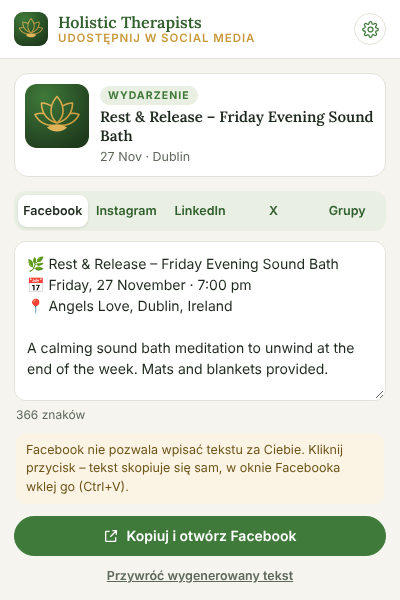
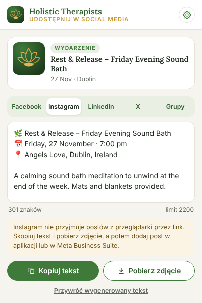

# HT Share – Chrome Extension

Create ready-to-share social media posts from articles, events and practitioner listings on [holistictherapists.ie](https://www.holistictherapists.ie).

## Screenshots

| Facebook | Instagram | X | Groups |
|---|---|---|---|
|  |  |  |  |

*The screenshots use a sample event. In normal use, the extension reads information from the page currently open in your browser.*

## Installation

1. Download or clone this repository.
2. Keep the extension folder in a location you will not delete.
3. In Chrome, open `chrome://extensions`.
4. Enable **Developer mode** in the top-right corner.
5. Click **Load unpacked** and select the extension folder.
6. Pin the lotus icon to your toolbar (Extensions menu → pin).

The extension also works in Brave and Microsoft Edge. Open `brave://extensions` or `edge://extensions` and follow the same steps.

## How to use

1. Open an article, event or practitioner listing on holistictherapists.ie.
2. Click the HT Share lotus icon in your browser toolbar.
3. Choose Facebook, Instagram, LinkedIn or X.
4. Review and edit the generated caption.
5. Use the relevant action:
   - **Facebook** – the caption is copied to your clipboard and the Facebook sharing window opens. Paste the caption with Ctrl+V and publish it yourself.
   - **LinkedIn / X** – open the platform's sharing interface and use the prepared text.
   - **Instagram** – copy the caption and download the image, then create the post in Instagram or Meta Business Suite.

HT Share does not publish posts automatically in this version and does not ask for your social media passwords. It opens the platforms in your existing signed-in browser session.

## Groups

1. Open the **Groups** tab.
2. Select **Add group** and enter a name and the group's URL. Facebook groups, LinkedIn groups and X communities can be saved.
3. Click **Copy and open** beside a saved group.
4. HT Share copies the prepared text and opens the selected group in a new tab. Paste the text into the platform's post composer and publish it yourself.

Additional group features:
- See which destinations you have marked as shared for each source URL.
- Use a slightly varied opening line for different groups.
- See a warning when several group shares have been initiated within a short period. Always follow each group's promotion rules and avoid repetitive posting.

The history records that you initiated the share workflow; it cannot independently verify that the platform accepted or published the post.

## Settings

Click the settings icon to configure:
- **Default hashtags** – appended to generated captions (default: `#HolisticIreland #Wellbeing`).
- **Include emojis** – enable or disable emojis in generated captions.

Topic hashtags (for example, #Reiki, #SoundBath and #Yoga) and Irish location hashtags (for example, #Dublin and #Cork) are selected from the page title and description.

## Where the extension gets its content

HT Share reads Open Graph metadata (title, description and image) and JSON-LD structured data. For events, it can also read the event date, time and location from Event structured data.

## Current limitations

- This version prepares captions and opens sharing destinations; it does not autonomously publish posts.
- Facebook and LinkedIn may change their sharing interfaces or restrict automated browser interaction.
- Publishing to groups may be restricted by each platform, group settings or moderation rules.
- Automatic scheduled posting, AI-generated copy through ChatGPT, and GitHub-based in-extension updates are not implemented in this version.
