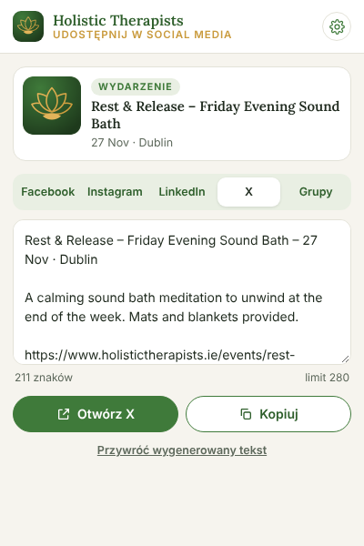
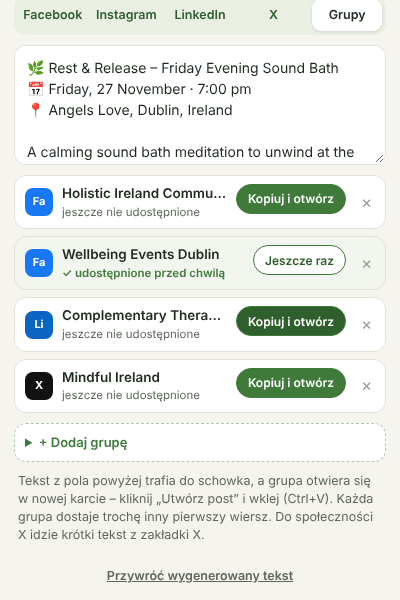

# HT Share – wtyczka do Chrome

Gotowe posty do social mediów z wpisów, wydarzeń i wizytówek na holistictherapists.ie.

## Zrzuty ekranu

| Facebook | Instagram | X | Grupy |
|---|---|---|---|
|  |  |  |  |

*Przykładowe wydarzenie; w prawdziwym użyciu wtyczka czyta dane z otwartej strony.*

## Instalacja

1. Rozpakuj `ht-share.zip` do folderu, którego nie będziesz usuwać.
2. W Chrome otwórz `chrome://extensions`.
3. Włącz **Tryb dewelopera** (prawy górny róg).
4. Kliknij **Załaduj rozpakowane** i wskaż rozpakowany folder `ht-share`.
5. Przypnij ikonę lotosu na pasku (ikona puzzla → pinezka).

Działa też w Brave i Edge (strona `brave://extensions` / `edge://extensions`).

## Jak używać

1. Otwórz wpis, wydarzenie lub wizytówkę na holistictherapists.ie.
2. Kliknij ikonę lotosu.
3. Wybierz Facebook, Instagram, LinkedIn albo X – tekst jest gotowy, możesz go poprawić.
4. Kliknij przycisk:
   - **Facebook** – tekst kopiuje się sam, otwiera się okno udostępniania; wklej tekst (Ctrl+V) i opublikuj.
   - **LinkedIn / X** – otwiera się okno posta z wpisanym tekstem i linkiem.
   - **Instagram** – kopiuj tekst i pobierz zdjęcie, potem dodaj post w aplikacji lub w Meta Business Suite.

Wtyczka niczego nie publikuje sama i nie potrzebuje haseł – korzysta z oficjalnych okien udostępniania, w których jesteś już zalogowany.

## Grupy (zakładka „Grupy”)

1. Kliknij **+ Dodaj grupę** i wpisz nazwę oraz link do grupy z Facebooka, LinkedIn albo społeczności X (`https://x.com/i/communities/…`; dostaje krótki tekst z zakładki X) (np. `https://www.facebook.com/groups/…`). Grupy zapisują się na stałe (synchronizują się z Twoim kontem Chrome).
2. Na stronie wpisu lub wydarzenia otwórz zakładkę **Grupy** i przy wybranej grupie kliknij **Kopiuj i otwórz**.
3. Tekst trafia do schowka, grupa otwiera się w nowej karcie – kliknij „Utwórz post” i wklej (Ctrl+V).

- Przy każdej grupie widać, czy ten post już tam był (✓ udostępnione…), żeby nie wrzucić go dwa razy.
- Każda grupa dostaje trochę inny pierwszy wiersz („Coming up:”, „Join us –”…), żeby post nie wyglądał wszędzie identycznie.
- Gdy w ciągu godziny wrzucisz link do 4 lub więcej grup, pojawi się ostrzeżenie – Facebook może zablokować publikowanie za spam.
- Sprawdzaj zasady grup: wiele zakazuje autopromocji albo pozwala na nią tylko w wybrane dni.

## Ustawienia (ikona zębatki)

- **Stałe hashtagi** – dodawane do każdego posta (domyślnie `#HolisticIreland #Wellbeing`).
- **Emoji w postach** – włącz/wyłącz 🌿 📅 📍.

Hashtagi tematyczne (#Reiki, #SoundBath, #Yoga…) i miasto (#Dublin, #Cork…) dobierają się same z tytułu i opisu.

## Skąd bierze dane

Z tagów Open Graph (tytuł, opis, zdjęcie) i ze schematu JSON-LD strony – przy wydarzeniach z daty i miejsca (schema Event z wtyczki HT Neon).
